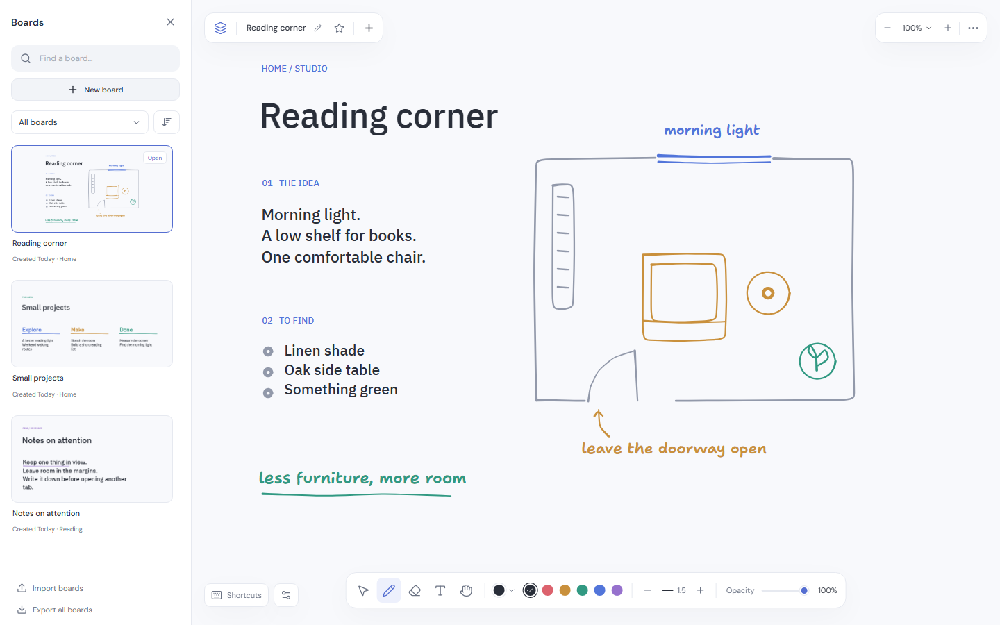

<div align="center">
  
  <h1>Folio</h1>
  <p>A quiet whiteboard for sketches, notes, and ideas.</p>
  <p>
    <a href="https://github.com/MaeglynD/canvas/actions/workflows/ci.yml"></a>
    
    <a href="https://tldraw.dev"></a>
  </p>
  <p>
    <a href="#preview">Preview</a> ·
    <a href="#run-locally">Run locally</a> ·
    <a href="docs/GUIDE.md">Guide</a> ·
    <a href="docs/DEPLOYMENT.md">Deploy</a> ·
    <a href="https://github.com/MaeglynD/canvas/issues">Feedback</a>
  </p>
  <br>
  <picture>
    <source media="(prefers-color-scheme: dark)" srcset="docs/media/folio-dark.png">
    
  </picture>
</div>

<br>

Folio keeps the canvas in focus: smooth ink, a small set of tools, and a board library that stays out of the way until you need it. Your work saves on your device. No account needed.

| Drawing                                                                                                            | Workspace                                                                                                     |
| :----------------------------------------------------------------------------------------------------------------- | :------------------------------------------------------------------------------------------------------------ |
| **Draw & write**<br>Pressure-aware ink, colours, stroke width, opacity, and text with adjustable wrapping.         | **Keep several boards**<br>Thumbnails, collections, favourites, search, and sorting by creation or last edit. |
| **Make the controls yours**<br>Editable shortcuts, smooth held-key zoom, Space to pan, and adjustable camera feel. | **Work in light or dark**<br>Matching canvas and previews, an optional dot grid, and independent snapping.    |
| **Take your work with you**<br>Editable single-board and whole-library backups. PNG and SVG exports for sharing.   | **Keep working offline**<br>Install the browser app after its first online load, or build the desktop app.    |

## Preview

<a href="docs/media/folio-demo.mp4">
  
</a>

[Watch / download the recording](docs/media/folio-demo.mp4) · [Light screenshot](docs/media/folio-light.png) · [Dark screenshot](docs/media/folio-dark.png)

## Run locally

Use **Node.js 24** and **pnpm 11.25.0**.

```sh
git clone https://github.com/MaeglynD/canvas.git
cd canvas
pnpm install
pnpm dev
```

Open **http://127.0.0.1:5173**. For a production build, run `pnpm build`. See the [deployment guide](docs/DEPLOYMENT.md) for Cloudflare hosting and the tldraw key needed on a public domain.

<details>
<summary><strong>A few useful controls</strong></summary>

<br>

| Action                              | Default                               |
| :---------------------------------- | :------------------------------------ |
| Select · Pen · Eraser · Text · Hand | `1` · `2` · `3` · `4` · `5`           |
| Pan                                 | Hold `Space` and drag, or middle-drag |
| Zoom in / out                       | Hold `E` / `Q`, or `Ctrl/Cmd` + wheel |
| Fit drawing / reset zoom            | `Z` / `R`                             |
| Previous / next toolbar colour      | `A` / `D`                             |
| Thinner / thicker stroke            | `S` / `W`                             |
| Lower / higher opacity              | `F` / `G`                             |
| Board library                       | `Ctrl/Cmd K`                          |
| Edit shortcuts                      | `/`                                   |

Every binding can be changed from **Shortcuts**. [Full controls and text guide →](docs/GUIDE.md#controls)

</details>

<details>
<summary><strong>Development & desktop</strong></summary>

<br>

```sh
pnpm test                         # Storage and backup checks
pnpm exec playwright install chromium
pnpm test:e2e                     # Browser interactions
pnpm build
pnpm test:offline                 # Production offline behavior
pnpm desktop                     # Open the built app in Electron
pnpm desktop:pack                # Package for the current OS
```

The manual desktop workflow builds Windows, macOS, and Linux packages. Public installers require the appropriate tldraw key and platform signing setup; there is no native auto-updater yet. [Desktop setup →](docs/GUIDE.md#desktop)

The UI is React + TypeScript; drawing is powered by tldraw. Vite builds the web app, IndexedDB stores documents and media, and Electron hosts the same app on desktop. [Architecture decisions →](docs/DECISIONS.md)

To reproduce the artwork, run `pnpm assets:icons`. With the dev server running, Chromium installed, and FFmpeg on your path, `pnpm docs:capture` creates the screenshots and recording using synthetic boards in a fresh browser profile.

</details>

## Your data

Boards stay in this browser profile, on this site address. They are **not synced or backed up to a server**. Clearing site data can erase them. Use **Export all boards** for a portable backup; import it to move between browsers, the desktop app, or a new domain. [Storage and imports →](docs/GUIDE.md#your-boards)

---

Built on [tldraw](https://tldraw.dev). Its SDK has its own [license](https://tldraw.dev/community/license); public deployments need a valid trial, hobby, or commercial key. Third-party notices are included with the app.
